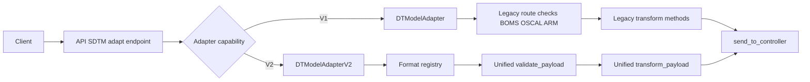
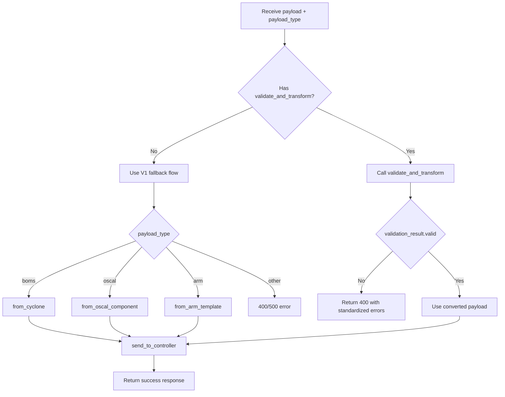
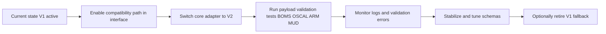

# Adapter V1 vs V2 Differences

## Scope
This document compares the SDT Manager adapters:

- V1: `DTModelAdapter` in `SDT-Manager/adapter_all.py`
- V2: `DTModelAdapterV2` in `SDT-Manager/adapter_all_v2.py`

## High-Level Summary

| Area | V1 (`DTModelAdapter`) | V2 (`DTModelAdapterV2`) |
|---|---|---|
| Validation model | Per-format checks implemented in route and adapter methods | Unified validation contract in adapter (`validate_payload`, `validate_and_transform`) |
| Error shape | Inconsistent, often exceptions or simple booleans | Standardized result object (`valid`, `format`, `schema_version`, `errors`, `warnings`) |
| Format dispatch | Endpoint branches manually by `payload_type` | Registry-based dispatch in adapter |
| Supported formats in unified flow | CycloneDX, OSCAL, ARM (manually handled) | CycloneDX/BOMS, OSCAL, ARM, MUD/MUDS |
| Schema validation | CycloneDX has schema-capable validator; others were basic checks | JSON-schema path for OSCAL/ARM/MUD + CycloneDX smart validation |
| Batch processing | Basic processing with limited validation consistency | Batch processing uses same validation/transform pipeline |
| Backward compatibility | Baseline behavior | Extends V1 and preserves inherited methods |

## Architecture Diagram

## Main Architectural Differences

### V1

- Core adapter class: `DTModelAdapter`
- Endpoint logic in `sdt_manager_interface.py` historically contained per-format validation and conversion branches.
- Validation output was mostly boolean or exceptions.
- No unified, structured validation response across formats.

### V2

- New class: `DTModelAdapterV2(DTModelAdapter)`
- Adds a format registry that maps payload type to:
  - validator
  - transformer
  - canonical name
  - schema version metadata
- Introduces unified methods:
  - `validate_payload(...)`
  - `transform_payload(...)`
  - `validate_and_transform(...)`
- Adds structured validation data model:
  - `ValidationIssue`
  - `ValidationResult`

## Validation Behavior Differences

### V1 behavior

- CycloneDX/BOMS: uses `validate_cyclonedx_smart(...)`.
- OSCAL and ARM: historically relied on lightweight key checks in endpoint logic.
- Validation and conversion were not standardized for API responses.

### V2 behavior

- One validation entrypoint for all formats (`validate_payload`).
- One validation+conversion pipeline (`validate_and_transform`).
- Standard error representation, suitable for consistent API responses.
- JSON Schema validation path included for OSCAL, ARM, and MUD when `jsonschema` is available.
- CycloneDX still uses `validate_cyclonedx_smart(...)` but normalized into the same result contract.

## New Format Support in V2

V2 adds first-class MUD support:

- payload aliases: `mud`, `muds`
- validator: `_validate_mud`
- transformer: `from_mud_profile`
- relationship extraction: `_extract_mud_relationships`

## Endpoint Integration Differences

Current interface behavior supports both adapters:

- If adapter has `validate_and_transform`: use V2 unified path.
- Otherwise: use legacy V1 fallback path (manual per-format branching).

This ensures existing deployments can continue with V1 while V2 is adopted.

## Request Flow Diagram

## Core Selection Differences

In `sdt_manager_core.py`, adapter selection is now manual via class assignment:

- `adapter_class = DTModelAdapterV2` (use V2)
- change to `adapter_class = DTModelAdapter` (use V1)

No runtime `else` branch is required for version switching.

## Dependency Differences

V2 expects `jsonschema` for full schema checks on OSCAL/ARM/MUD.

- Added in `SDT-Manager/requirements.txt`

If `jsonschema` is missing, V2 still runs but returns warnings that schema checks were limited.

## Compatibility Notes

- V2 is implemented as an extension of V1, so inherited conversion methods remain available.
- Endpoint compatibility fallback prevents immediate breakage for V1 users.
- Response payload in V2 path includes validation details and conversion timing.

## Operational Impact

### Benefits of V2

- Consistent validation behavior across formats.
- Cleaner endpoint code (adapter owns validation/transform orchestration).
- Better error observability for clients and logs.
- Easier to add new formats through registry extension.

### Trade-offs

- Additional module complexity (`adapter_all_v2.py`).
- Requires `jsonschema` dependency for full schema enforcement.
- Teams should align on a single adapter class in core to avoid confusion.

## Migration Guidance

1. Keep interface compatibility fallback enabled.
2. Start with `adapter_class = DTModelAdapterV2` in core.
3. Validate production payloads for all required formats (BOMS, OSCAL, ARM, MUD).
4. Monitor validation warnings/errors after rollout.
5. Optionally remove V1 fallback once V2 is fully adopted.

## Migration Timeline Diagram

## Tested Status (Current Session)

Direct `DTModelAdapterV2.validate_and_transform(...)` tests were executed for:

- BOMS (real repo sample: `timestamps_component/VEX.json`)
- ARM (generated minimal valid payload)
- OSCAL (generated minimal valid payload)
- MUD (generated minimal valid payload)

All four validated and transformed successfully in the test run.
