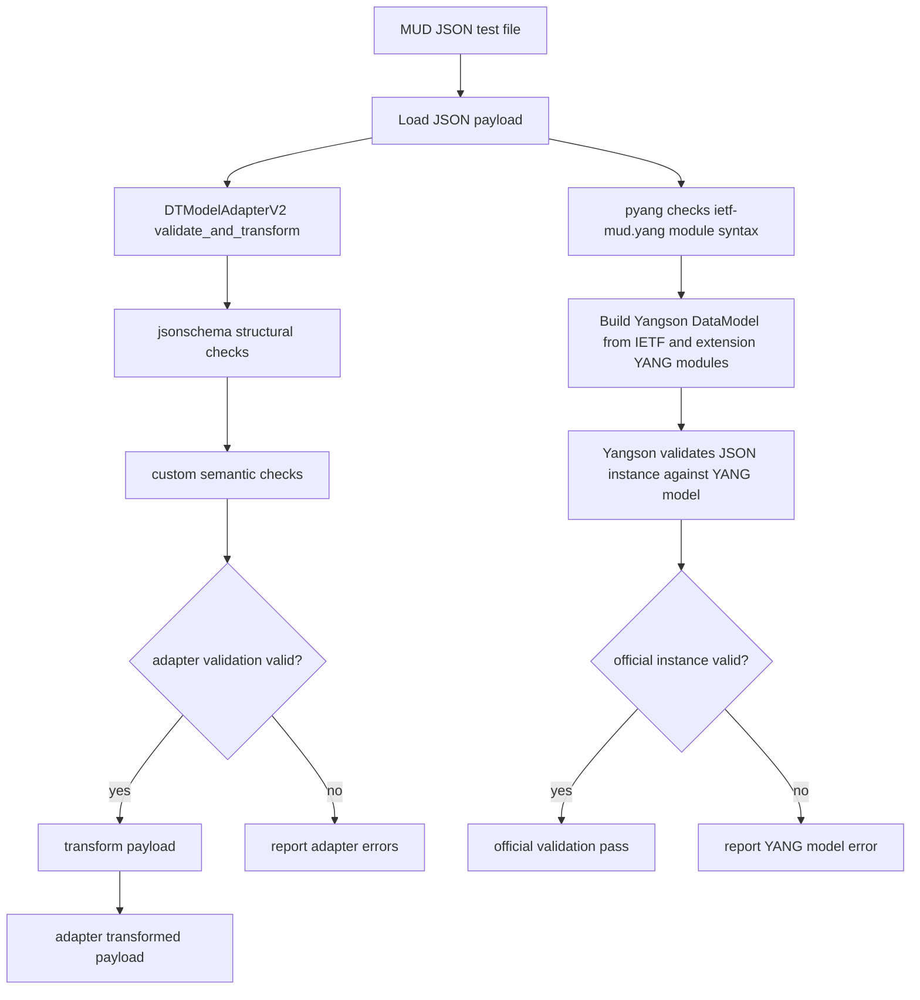
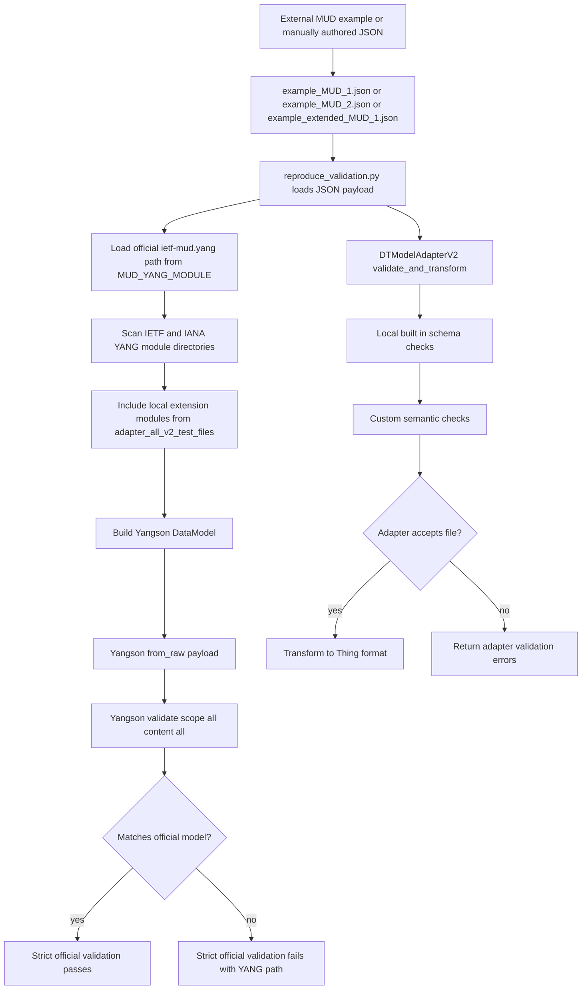

# MUD Validation Flow

This diagram shows the current validation flow used by [reproduce_validation.py](/home/sdtm/SDTM/SDT-Manager/SDT-Manager/adapter_all_v2_test_files/reproduce_validation.py).

## What Each Step Means

1. `pyang`
- Checks that the official `ietf-mud.yang` module itself is syntactically valid.

2. `Yangson`
- Builds a YANG data model from the available YANG modules.
- Validates each MUD JSON file against the official IETF model and any loaded extension modules.

3. `DTModelAdapterV2`
- Runs application-level validation through `validate_and_transform(...)`.
- Uses `jsonschema` plus custom semantic checks.
- If valid, transforms the payload into the adapter's Thing structure.

## Why Results Can Differ

- Official validation is strict against the IETF YANG model.
- Adapter validation follows your application's accepted rules.
- A payload can pass adapter validation but still fail official validation if it includes non-standard extensions.

## File Origin And Strict Validation

This diagram shows the most likely lifecycle of the current test files based on the repo state.

## Notes About The Current Files

- These files do not appear to be generated by a script in this repo.
- They are most likely hand-authored test fixtures or copied from external examples and then edited.
- Strict validation is the Yangson path in `reproduce_validation.py`, not the adapter path.